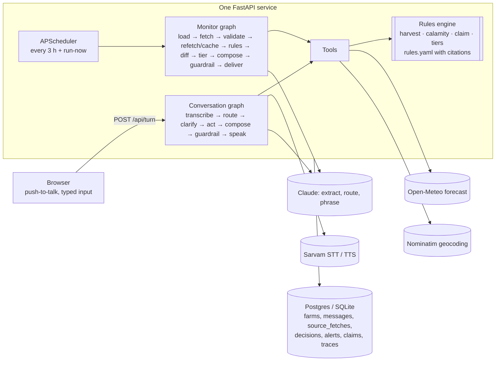

# Fosol Sathi

A website where a Bengali-speaking paddy farmer, or their family, talks to an agent that knows their field.
It tells them the safe days to cut paddy, warns before heavy rain, and runs a 72-hour insurance claim kit
after a storm. A scheduled agent re-checks every farm, speaks only when a decision changes, and attaches
a source and fetch time to every number.

**Rules decide; the LLM only extracts, routes and phrases.** Every reply passes a number guardrail: each
number in it must appear in that turn's tool outputs, or the reply is regenerated once and then replaced by
a template.

## Architecture



| Path | What |
| --- | --- |
| `app/main.py` | Routes, sessions, scheduler, operator API |
| `app/rules/` | Pure rule functions: `harvest.py`, `calamity.py`, `claim.py`, `blight.py`, `sowing.py`, `tiers.py` |
| `app/agent/monitor_graph.py`, `convo_graph.py` | The two LangGraph graphs |
| `app/agent/tools.py` | Tools shared by both graphs; decision recording, change detection, claim kits |
| `app/agent/guardrail.py` | Number, source and no-action-claim checks |
| `app/sources/` | Open-Meteo (fetch, 6-hour labelled cache, validation), Nominatim, the source-outage switch |
| `app/llm/` | Claude client (structured outputs, 8 s timeout, server-side refusal fallback) and prompt contracts |
| `app/speech/sarvam.py` | ffmpeg webm→16 kHz WAV, Saaras v3 STT, Bulbul v3 TTS |
| `app/web/` | Server-rendered pages, `app.js` (no build step), `strings/bn.json`, `strings/en.json` |
| `rules.yaml` | Every threshold with its source; `team` marks our own design choices |

## Setup

Python 3.11+ and ffmpeg.

```bash
python -m venv .venv && . .venv/bin/activate
pip install -r requirements-dev.txt
cp .env.example .env   # paste SARVAM_API_KEY and LLM_API_KEY
python -m scripts.check_services   # one live call to each outside service
uvicorn app.main:app --reload
```

| Variable | Purpose |
| --- | --- |
| `DATABASE_URL` | Postgres URL (Supabase); defaults to `sqlite:///local.db` |
| `SARVAM_API_KEY`, `SARVAM_SPEAKER` | Speech to text and text to speech; speaker optional |
| `LLM_PROVIDER`, `LLM_API_KEY`, `LLM_MODEL` | `anthropic` + key; model defaults to `claude-opus-5-5`. `none` = template replies only |
| `OPS_PASSCODE` | Operator view at `/ops` |
| `SESSION_SECRET` | Signs the farm session cookie |
| `NOMINATIM_USER_AGENT` | Required by the Nominatim usage policy; include a contact |
| `SCHEDULE_HOURS` | Monitor interval, default 3 |
| `ENABLE_SCHEDULER` | `0` turns the in-process scheduler off (tests) |

Without keys the app still runs: typed input works, replies are templates, voice replies are off with a notice.

### Deploy

`Dockerfile` builds `python:3.11-slim` with ffmpeg. On Render or Railway use a paid always-on instance
(free tiers sleep) and a **single** instance: the scheduler runs in-process. Point `DATABASE_URL` at Postgres
so data survives redeploys.

## Tests

```bash
pytest
```

- Rule unit tests on a saved real Open-Meteo response for Paschim Medinipur (fetched 31 Oct 2026) in
  `tests/fixtures/`. The running app never reads it.
- Guardrail: 10 planted wrong numbers, all caught.
- End to end through the API: profile one field at a time, read-back and correction, harvest answer with
  source, monitor run delivers once then stays silent, heavy rain opens a Red alert and a claim kit with a
  72-hour deadline, and the pulled-plug test (labelled cache, then "forecast unavailable", no unhandled error).
- Extraction golden set (20 utterances): the test reports the fallback parser's per-field score;
  `python -m scripts.eval_extraction` scores the LLM extractor (needs a key; spends credits).

## Demo script

1. Open the site on a phone. Tap the mic: "আমি গোপাল। শালবনি, পশ্চিম মেদিনীপুর। ৩ বিঘা আমন ধান, পেকে গেছে।"
2. Sathi asks for anything missing, one question at a time, then reads the profile back. Say "হ্যাঁ".
3. It answers with the safe cut days and names the forecast source and fetch time. Tap **কেন এই পরামর্শ**.
4. On `/ops`, set a farm in a live heavy-rain location to *cut* and *insured*, press **Run now**: a Red alert
   and a claim kit with a countdown appear. Open the kit, copy the report message, mark it sent.
5. Pulled plug: switch **Open-Meteo** off on `/ops`, press **Run now**, ask again. The agent uses the last real
   fetch under 6 hours, labelled with its time; with no such fetch it says the forecast is unavailable.

## Known limits

- Past-day rain is a model estimate, not a rain gauge; it is labelled "estimated" in the claim kit.
- Days run midnight to midnight IST, not IMD's 08:30 to 08:30.
- Blight watch runs a station-validated rule on forecasts; the app says so on its Why page.
- Hindi: detected by the router; replies in Hindi only when the LLM is on.
